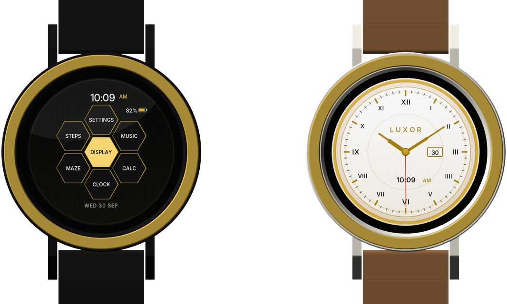
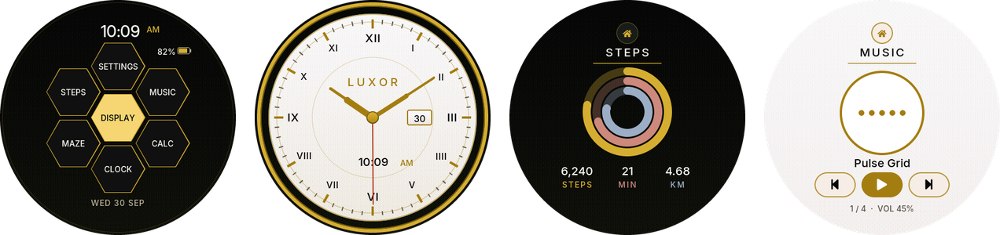
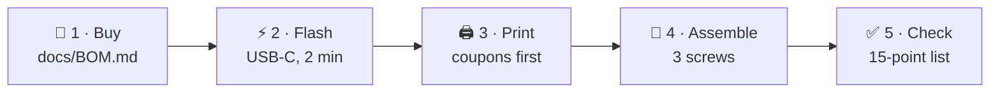
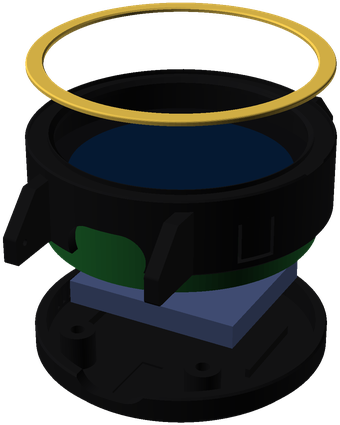
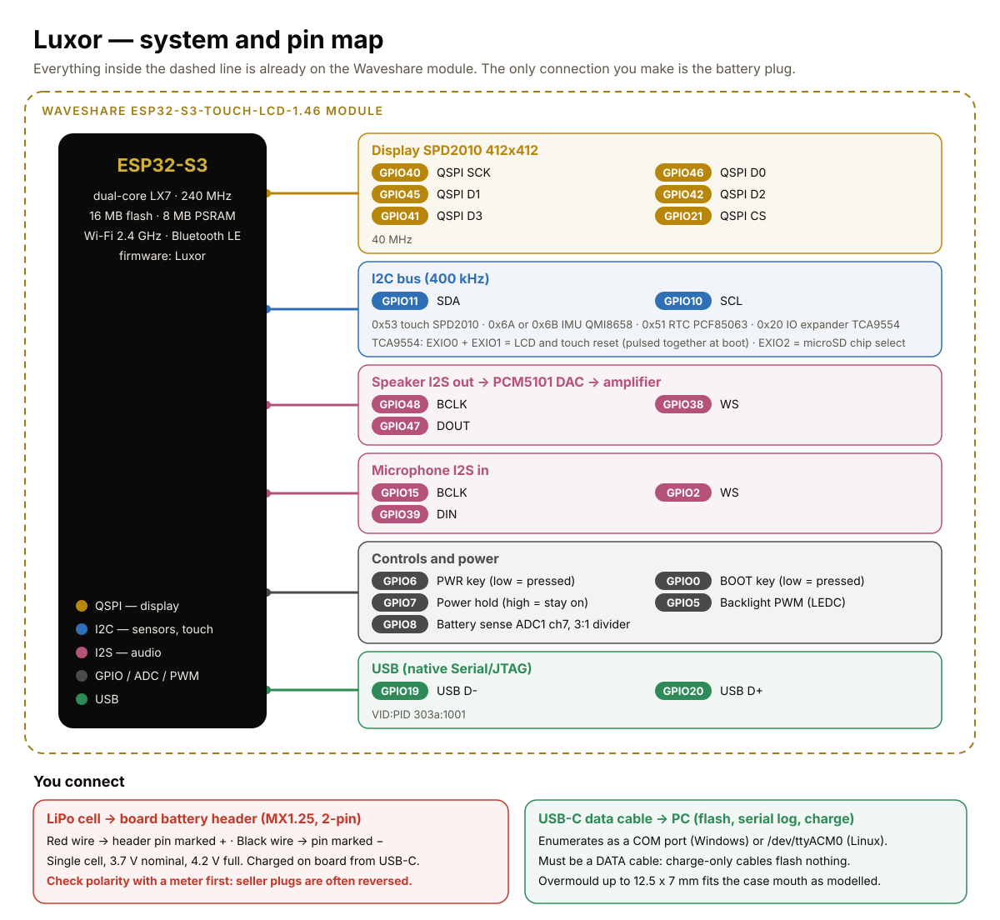

<div align="center">

# LUXOR

**An open-source luxury smartwatch you can build at home.**<br>
ESP32-S3 · 1.46″ round touchscreen · 3D-printed case with a gold bezel · ~$60–100 in parts

[](https://github.com/Normansrule/luxor-watch/actions/workflows/build.yml)


[](LICENSE.txt)





</div>

## What you get

| Part | What's in it |
|---|---|
| ⌚ **Firmware** | Clock with a dress dial, 7-app launcher, steps with activity rings, music, calculator, tilt maze, settings. Six themes, the Inter typeface, fades and press feedback |
| 🖨️ **Case** | Parametric OpenSCAD: shell with integral 22 mm lugs and hole-free buttons, screw-on back cover, silk-gold bezel inlay, nightstand dock. Every part prints without supports |
| 📋 **Docs** | [Bill of materials](docs/BOM.md) · [pin-by-pin wiring](docs/WIRING.md) · [requirements](docs/REQUIREMENTS.md) · [assembly](hardware/ASSEMBLY.md) · [hardware checks](docs/HARDWARE_CHECKS.md) |
| ✅ **Checks** | Host tests, a UI simulator that audits every screen, and fit and printability checks on the CAD, all run in CI (continuous integration) |

## Build one in five steps



### 1 · Buy

One Waveshare module is the whole watch. Add a 402530 LiPo cell, three M2×6 screws and a 22 mm quick-release strap. Full list with specs and prices: **[docs/BOM.md](docs/BOM.md)**.

> [!IMPORTANT]
> Buy the module **with cover glass**: the case's front lip holds the glass. Waveshare lists that variant as **ESP32-S3-Touch-LCD-1.46**, and the **1.46B** *without* glass.

### 2 · Flash

**No toolchain:** download `bootloader.bin`, `partition-table.bin` and `luxor_v9.bin` from the [latest release](https://github.com/Normansrule/luxor-watch/releases/latest), then:

```bash
python3 -m venv ~/.venvs/esptool && ~/.venvs/esptool/bin/pip install -q esptool
~/.venvs/esptool/bin/python -m esptool --chip esp32s3 -b 460800 write_flash \
  0x0 bootloader.bin  0x8000 partition-table.bin  0x10000 luxor_v9.bin
```

Windows: `pip install esptool`, then the same `python -m esptool …` line. Or run `prebuilt\FLASH_PREBUILT_V9.cmd COM5`.

**From source** (ESP-IDF 5.5.5):

```bash
idf.py set-target esp32s3
idf.py build
idf.py -p /dev/ttyACM0 flash monitor      # Windows: -p COM5
```

The first serial line reads `=== Luxor v9 boot ===`.

### 3 · Print

| Part | STL | Material |
|---|---|---|
| Test coupons **A · B · C** (print first) | [A](hardware/stl/coupon_A.stl) · [B](hardware/stl/coupon_B.stl) · [C](hardware/stl/coupon_C.stl) | as the real parts |
| Case shell | [01_case_shell](hardware/stl/01_case_shell.stl) | matte black or ivory PLA+ / PETG |
| Back cover | [02_back_cover](hardware/stl/02_back_cover.stl) | same |
| Bezel inlay | [03_bezel_ring](hardware/stl/03_bezel_ring.stl) | silk gold PLA |
| Dock (optional) | [04_charging_dock](hardware/stl/04_charging_dock.stl) | any PLA |

Click an STL to spin it in 3D on GitHub. Settings: 0.12 mm layers, 4 walls, 40 % infill, no supports. Full guide: **[hardware/README.md](hardware/README.md)**.

<p align="center">
  <picture>
    <source media="(prefers-color-scheme: dark)" srcset="docs/images/exploded_ivory.png">
    
  </picture>
</p>

### 4 · Assemble

The board drops into the shell glass-first, the battery sits in the back cover's cradle, and three M2 screws close it. **[hardware/ASSEMBLY.md](hardware/ASSEMBLY.md)** has the eight steps.

You make one electrical connection: the battery plug. Everything else is on the module.

<a href="docs/WIRING.md"></a>

> [!WARNING]
> **Check battery polarity with a meter before plugging in.** MX1.25 plugs are sold wired both ways, and a reversed cell can destroy the charger. Run the watch on battery for the first time off the wrist, on a non-flammable surface. Steps: [docs/WIRING.md](docs/WIRING.md#the-one-connection-you-make-the-battery).

### 5 · Check

Work down **[docs/HARDWARE_CHECKS.md](docs/HARDWARE_CHECKS.md)**: boot, touch, rings, music, tilt, battery reading. **[docs/REQUIREMENTS.md](docs/REQUIREMENTS.md)** shows which requirement each check proves.

## Using it

| Do | Result |
|---|---|
| Tap a dark screen · raise your wrist | wake |
| Double-tap empty space · press BOOT | home |
| Triple-tap empty space | screen off / on |
| Hold PWR 3 s | power off |

## Status

| | Host (PC) | On the watch |
|---|:-:|:-:|
| Firmware builds clean with ESP-IDF 5.5.5 | ✅ | — |
| Geometry, gestures, motion and battery tests | ✅ | ☐ |
| Every label fits; every control has a 44 px touch area | ✅ | ☐ |
| CAD: no collisions, watertight, support-free | ✅ | — |
| Coupons A · B · C printed and passed | — | ☐ |
| Untethered on battery | — | ☐ |

Some board dimensions in [`luxor_params.scad`](hardware/luxor_params.scad) are tagged **ASSUMED**: the screw-post origin, the button positions and the USB-C depth. The coupons exist to confirm them before you print full parts.

## Repository map

```
main/              firmware (ESP-IDF component): ui.c, board.c, battery.c, motion.c …
tests/             host tests — make -C tests
tools/ui_sim/      UI simulator: renders and audits the real ui.c on a PC
hardware/          OpenSCAD sources, STLs, renders, fit/print checks, assembly
docs/              BOM, wiring, requirements, hardware checks, images
prebuilt/          ready-to-flash binaries
```

## Develop

```bash
make -C tests                                        # host tests, no hardware
git clone --depth 1 -b v8.3.11 https://github.com/lvgl/lvgl ~/lvgl
make -C tools/ui_sim LVGL_DIR=~/lvgl check gallery   # audit + render every screen
cd hardware && python3 check_fit.py && python3 check_print.py
```

Every geometry change starts with a test in `tests/test_layout.c`. See [CHANGELOG.md](CHANGELOG.md).

## Roadmap

microSD storage readout · display follows wrist rotation · music playback from LittleFS · battery-life measurement and deeper sleep.

## License

Firmware, CAD and docs: [MIT](LICENSE.txt). Inter font: SIL OFL 1.1. Third-party code: [THIRD_PARTY_NOTICES.md](THIRD_PARTY_NOTICES.md). "Luxor" is this project's own name; no third-party marks or dial art are used.
