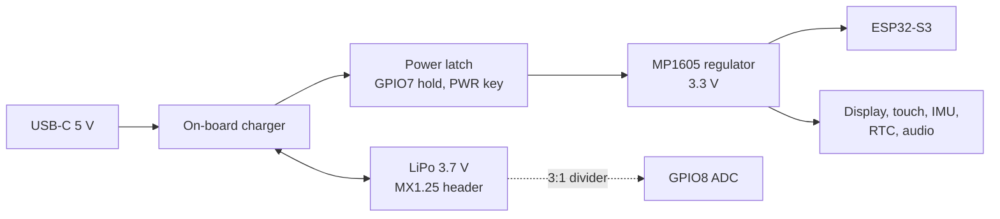

# Wiring and pin map

**You solder nothing.** Every part of the watch except the battery is already on the Waveshare module. This page is the pin reference for the firmware and for anyone porting Luxor to another board.

## The one connection you make: the battery

| Step | Do this | Why |
|---|---|---|
| 1 | Find the 2-pin **MX1.25** battery header on the back of the board and photograph its **+ / −** silkscreen | Sellers ship MX1.25 plugs wired both ways |
| 2 | Put a multimeter on the cell's plug: **red probe on the pin you will plug into +** | It must read +3.6 to +4.2 V. A negative reading means the plug is reversed. **Stop:** reversing a cell can destroy the charger |
| 3 | If the plug is reversed, swap the two crimps in the housing (lift each latch with a pin), or buy the other polarity | Never cut and twist wires inside a watch |
| 4 | One layer of Kapton tape on the board where the cell sits, then plug in | Stops the cell's foil touching components |
| 5 | First run on battery: off the wrist, on a non-flammable surface, 10 minutes; check Settings → About shows a sensible voltage | Catches a bad cell before you wear it |

Cell spec: single-cell lithium-polymer (LiPo), 3.7 V nominal / 4.2 V full, with a protection circuit (PCM). **402530** (4.0 × 25 × 30 mm, ~250 mAh) fits the back-cover cradle as modelled. Until the board's charge current has been checked against your cell, leave the battery unplugged while USB-C is connected.

## ESP32-S3 pin map

Source of truth: `main/board.c` and `main/audio.c`. If you change a pin there, change it here and re-run `docs/images/make_wiring_svg.py`.

| GPIO | Signal | Dir | Goes to | Notes |
|---:|---|:---:|---|---|
| 40 | QSPI SCK | out | Display SPD2010 | SPI2 host, 40 MHz |
| 46 | QSPI D0 | i/o | Display | |
| 45 | QSPI D1 | i/o | Display | |
| 42 | QSPI D2 | i/o | Display | |
| 41 | QSPI D3 | i/o | Display | |
| 21 | QSPI CS | out | Display | |
| 11 | I2C SDA | i/o | Touch, IMU, RTC, IO expander | 400 kHz bus (touch device at 100 kHz) |
| 10 | I2C SCL | out | same | |
| 48 | I2S BCLK | out | PCM5101 DAC → amplifier → speaker | I2S0 TX |
| 38 | I2S WS | out | PCM5101 | |
| 47 | I2S DOUT | out | PCM5101 | |
| 15 | I2S BCLK | out | Microphone | I2S1 RX |
| 2 | I2S WS | out | Microphone | |
| 39 | I2S DIN | in | Microphone | |
| 6 | PWR key | in | Side button | active low, internal pull-up |
| 0 | BOOT key | in | Side button | active low; held at reset = download mode |
| 7 | Power hold | out | Power latch | drive **high** at boot to stay on; low = power off |
| 5 | Backlight | out | LCD backlight | LEDC PWM, 5 kHz |
| 8 | Battery sense | in | Cell through 3:1 divider | ADC1 channel 7, 12 dB attenuation, curve-fit calibration |
| 19 | USB D− | i/o | USB-C | native USB Serial/JTAG |
| 20 | USB D+ | i/o | USB-C | VID:PID 303a:1001 |

## I2C devices (GPIO11 / GPIO10)

| Address | Chip | Role | If it is missing |
|---|---|---|---|
| 0x20 | TCA9554 IO expander | EXIO0 + EXIO1 = LCD and touch reset (pulsed low together at boot); EXIO2 = microSD chip select | panel reset may be unreliable (logged) |
| 0x51 | PCF85063 | real-time clock (RTC), keeps time while off | time comes from Wi-Fi or Settings → Time |
| 0x53 | SPD2010 | touch controller | display still runs; touch disabled (logged) |
| 0x6A or 0x6B (probed) | QMI8658 | 6-axis inertial measurement unit (IMU): tilt, steps, wrist raise | motion features off |

## Power path (simplified)

Inferred from the firmware's behaviour and Waveshare's product page; the module's own schematic is the authority.

## Mechanical interfaces the case relies on

These are board facts the 3D models depend on. Values tagged **ASSUMED** in `hardware/luxor_params.scad` are not yet measured. Coupon B and coupon A confirm them before you print the full parts.

| Interface | Parameter | Status |
|---|---|---|
| 3 × M2 brass standoffs | `standoff_xy`, `standoff_depth` | pitch from the Waveshare drawing, origin ASSUMED |
| Cover-glass diameter | `glass_od` | MEASURE |
| USB-C receptacle depth behind the glass | `usb_depth` | ASSUMED |
| PWR / BOOT switch angles and depth | `button_angles`, `button_depth` | ASSUMED |
| Deepest part on the back | `board_depth` | from the Waveshare drawing |
