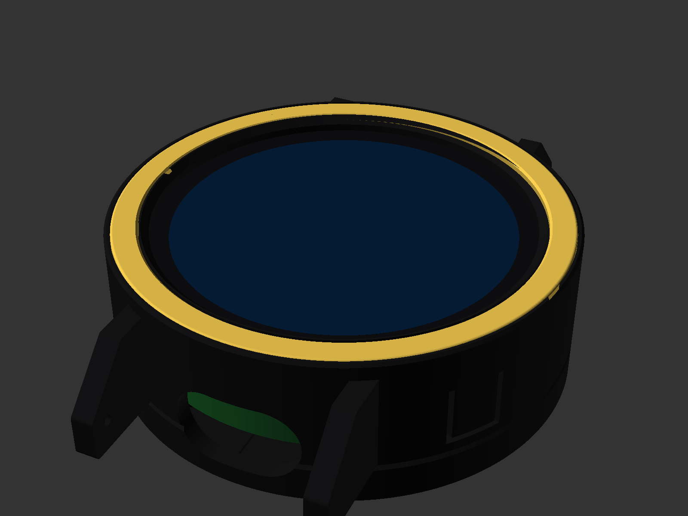

# Luxor case — printable 3D models

Everything is parametric OpenSCAD. Every dimension lives in `luxor_params.scad` with a tag saying where it came from:

| Tag | Meaning |
|---|---|
| FIXED | decided (Ø50.2 mm outer, 2 mm wall, Ø46.2 mm bore) |
| DRAWING | Waveshare structural drawing, as recorded in the ORBIT B4 files |
| ASSUMED | carried from the ORBIT B-series cases; **not verified on your board** |
| MEASURE | take it with calipers, or from the Waveshare STEP in Onshape |
| DESIGN | a free styling or fit choice |

The render stops with an error if a value is impossible (lip wider than the glass, a boss inside the battery, …) and prints the watch thickness and the M2 screw length.



## Parts

| # | File | What it is | Print | Approx. |
|---|---|---|---|---|
| 1 | `parts/01_case_shell.scad` | shell: glass lip, black inner bezel, gold-inlay pocket, integral 22 mm lugs, two seamless flexure buttons, USB-C mouth, mic hole | face-down as exported, no supports | 4.7 cm³, ~6 g |
| 2 | `parts/02_back_cover.scad` | back cover: three standoff bosses with counterbored M2 holes, battery cradle, speaker slots, engraved back | back-down as exported, no supports | 3.8 cm³, ~5 g |
| 3 | `parts/03_bezel_ring.scad` | gold bezel inlay with engraved hour indices (optional two-tone) | flat, no supports | 0.3 cm³ |
| 4 | `parts/04_charging_dock.scad` | upright nightstand dock that holds a USB-C plug pointing up | base-down, no supports | 57 cm³, ~70 g |
| — | `coupons.scad` | A lip/bore/inlay band · B standoff plate · C lug pair — **print first** | as exported | 2.4 + 2.6 + 1.2 cm³ |

STLs for all of the above are in `stl/` (rendered from the current parameters). Re-render everything after any change, then confirm:

```bash
./render_all.sh                       # writes stl/
python3 check_print.py                # watertight, on the bed, no overhang past 45°
python3 check_fit.py                  # no collisions (about 2 minutes)
```

CI re-renders every STL and fails if a committed one no longer matches its source (`check_stl_fresh.py`).

README images: `hero.scad` is a render-only scene (watch on a strap); `renders/make_hero.py` renders it and puts the simulator's real UI frame on the glass. `renders/make_exploded.py` makes the noir/ivory exploded views.

## Print settings

| Part | Material | Layer | Walls | Infill | Notes |
|---|---|---|---|---|---|
| Shell, cover | PLA+ or PETG, matte black or ivory | 0.12 mm (0.16 OK) | 4 | 40 % | textured PEI gives the front and back a satin finish |
| Bezel inlay | silk gold PLA | 0.08–0.12 mm | 3 | 100 % | |
| Dock | PLA, any colour | 0.2 mm | 3 | 20 % | |
| Coupons | same as the real part | same | same | same | |

`python3 check_print.py` confirms every STL is one watertight body on the bed and that nothing overhangs past 45° except short bridges (widest: the 3 mm inlay-pocket floor).

## Fit checks before printing

`python3 check_fit.py` renders the assembled watch and fails on any clash between shell, cover, inlay, glass, the board envelope and the battery. The flexure nubs are the one intended contact: they must just touch the board edge (currently 0.55 mm³).

## Order of operations

1. **Measure** and update `luxor_params.scad` (Onshape STEP is fine). In order of importance:
   - standoff X/Y ×3 (`standoff_xy`), standoff tip depth behind the glass face (`standoff_depth`)
   - cover-glass diameter (`glass_od`), deepest part on the back (`board_depth`)
   - PWR/BOOT switch angles and depth (`button_angles`, `button_depth`), and how far each switch sits inside the board edge (`flex_reach`)
   - USB-C receptacle centre depth (`usb_depth`) and your cable's overmould size (`cable_w`, `cable_h`)
   - battery size with wrap (`batt_l`, `batt_w`, `batt_t`) and the standoff thread depth (`m2_engage`)
2. Run `python3 check_fit.py` and `python3 check_print.py`.
3. **Coupon B** on the back of the board — an M2 screw must start in all three standoffs at once.
4. **Coupon A** — board drops in glass-first, cannot pass the lip, whole display visible, gold inlay sits flush.
5. **Coupon C** — the spring bar snaps into the lug holes and holds the strap.
6. Print parts 1–3, then assemble (`ASSEMBLY.md`). Print the dock any time.

## Design notes

- **Seamless buttons.** No holes: a U-slot frees a 5 × 6 mm tab in the wall, hinged at its front end and thinned to 1.2 mm from inside; a nub on the tab presses the switch. If a tab feels stiff, lower `flex_t`; if it doesn't reach, raise `flex_reach`.
- **Two-tone bezel.** The gold inlay sits in a 0.8 mm pocket framed by a fine black ring inside and a 0.6 mm black rim outside. The front stays flat, so the shell prints face-down with a satin bed finish. Set `bezel_ring = false` for a plain front with a rounded edge.
- **Clamping.** The three M2 screws pull the cover onto the board's standoffs. The shell is trapped between the cover rim and the glass, through a 0.3 mm gasket that takes up tolerance. A key at 12 o'clock stops the shell rotating, so the buttons and the USB-C mouth always line up.
- **Charging.** The lower spring bar sits right in front of the USB-C mouth, so to charge you unclip the lower strap half (quick-release), or stand the watch in the dock.
- **Thickness.** 18.4 mm with a 4.2 mm cell. A 3 mm cell (`batt_t = 3.2`) gives 17.4 mm and roughly half the capacity.
